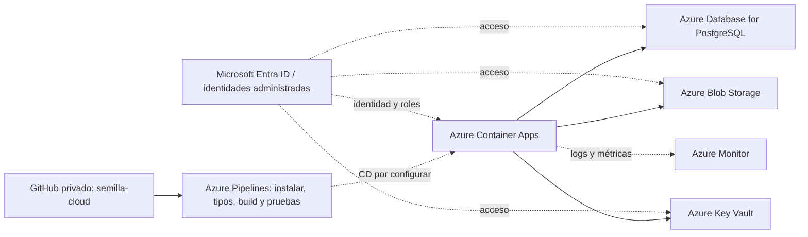

# Siete servicios integrados en Asistente Negocios

Estado verificado el 22/10/2026. Esta sección reemplaza las propuestas y estados históricos conservados debajo.

| Servicio | Función implementada | Evidencia |
|---|---|---|
| Container Apps | Ejecuta Next.js y API con HTTPS, mínimo 0 y máximo 1 | publicacion-real.json y cicd-despliegue.json |
| PostgreSQL | Negocios, movimientos, inventario y sesiones compartidas | PostgreSQL migrado y pruebas transaccionales documentadas |
| Blob Storage | Comprobantes privados con sesión y membresía | publicacion-real.json y comprobantes-azure.md |
| Entra ID, RBAC e identidad administrada | Acceso del servidor y federación CI con permisos acotados | cicd-identidad.json y publicacion.md |
| Key Vault | Credenciales de PostgreSQL y Google recuperadas por el servidor | keyvault.md y publicacion-real.json |
| Azure Monitor | Eventos estructurados persistentes, consultas y alerta de errores | monitor-real.json y monitor-alertas.json |
| GitHub Actions hacia Azure | Prueba, construye y despliega automáticamente | Run 39864595655 y cicd-despliegue.json |

ACR es auxiliar. Google identifica a las personas, sin inflar la cuenta de siete. El Word admite CI/CD hacia cloud; la evaluación final corresponde al docente. El grupo, la suscripción, los roles y cada contenedor no cuentan como servicios distintos.

El usuario recibió el aviso de incorporación al grupo de alertas. La entrega por incidente no se ejercitó y Free Trial bloqueó su endpoint de prueba. Los avisos de gasto, la restauración comprobada y la medición de capacidad siguen como mejoras posteriores.

Documentación actual: [plan del curso](requisitos/plan-segun-curso.md), [Monitor](observabilidad.md), [CI/CD](cicd.md), [presentación y guion](presentaciones/README.md).

## Historia del proyecto, estados anteriores

El resto conserva el avance del 17–19/10. Las menciones de pendiente y Azure Pipelines describen ese momento, no la implementación actual. La solución activa usa GitHub Actions, Google para personas e identidad Azure para el servidor. PostgreSQL se autentica con rol SQL y credencial de Key Vault, no directamente con Managed Identity.

## Conexiones reales verificadas el 19/10/2026

El backend Next.js se ejecutó en el equipo local autenticado con la sesión Azure CLI. Listó Blob Storage, escribió un comprobante sintético y lo recuperó mediante la API. También leyó el secreto prueba-conexion de Key Vault sin exponer su valor. Una consulta sin token de demo devolvió 401. Evidencia: [conexion-azure-real-2026-10-19.json](../evidencias/conexion-azure-real-2026-10-19.json).

Dos servicios conectados y verificados desde el programa: Blob Storage y Key Vault. Microsoft Entra ID autentica la sesión de desarrollo. El uso de id-cloud-app-dev desde Container Apps aún no se ha probado. No hay una URL pública ni PostgreSQL integrado. La prueba cloud sigue separada del flujo del negocio con SQLite.

Para repetir: configura .env.local según .env.example, inicia sesión con Azure CLI y ejecuta npm run dev:cloud. Para la prueba automatizada del equipo de Lizardo: node scripts/verificar-azure-real.mjs. Este script usa los nombres de recursos del proyecto, crea un comprobante sintético real en cada ejecución y necesita la sesión Azure CLI con permisos. No ejecutarlo en CI sin configurar identidad y recursos de prueba.

## Registro anterior y guía de configuración

# Servicios cloud acordados y ruta de integración

Selección indicada por el equipo el 17/10/2026. Esta lista reemplaza la propuesta anterior que contaba ACR o IA dentro de los siete. No representa siete servicios desplegados. Su aceptación académica se contrasta con el Word/docente cuando esté disponible.

| Servicio acordado | Responsabilidad | Qué falta comprobar |
|---|---|---|
| Azure Container Apps | Ejecutar web y backend | Imagen, revisión disponible, URL compartida y pruebas de aplicación. |
| Azure Blob Storage | Comprobantes e imágenes de productos privados | Escritura/lectura desde backend y acceso privado comprobado. La demo solo implementa comprobantes; carga de imágenes de productos pendiente. |
| Azure Database for PostgreSQL | Usuarios, negocios, ventas, gastos e inventario | Migraciones, driver y persistencia compartida; SQLite actual no se despliega como base compartida. |
| Microsoft Entra ID e identidades administradas | Identidad entre servicios y roles acotados | Identidades, permisos y evidencias de acceso/rechazo. El inicio de sesión de personas requiere una configuración adicional. |
| Azure Monitor | Logs, errores, rendimiento y alertas | Instrumentación, destino persistente, alerta y evidencia de funcionamiento. |
| Azure DevOps / Azure Pipelines | Pruebas y despliegue al actualizar código | Conectar GitHub y ejecutar CI; después añadir CD con conexión Azure por federación. |
| Azure Key Vault | Secretos del backend | Vault, permisos de lectura de la identidad y referencias al secreto desde Container Apps. El secreto propio de la demo Container Apps no equivale a Key Vault configurado. |

ACR puede apoyar el almacenamiento de imágenes del contenedor, pero no sustituye uno de los siete acordados. El proveedor de IA sigue pendiente de elección e integración; no se añade ni activa automáticamente.

## Qué resuelve GitHub ahora

Un repositorio privado permite compartir, revisar y combinar avances de código y documentación. Cada integrante ejecuta la versión local con su propia base. Publicar el código en GitHub no convierte Next.js y SQLite en una aplicación web compartida, y GitHub Pages no ejecuta este backend.

La URL para que ambos vean y modifiquen la misma información llegará con Container Apps y PostgreSQL. Las rutas `/api/local` actuales permanecen limitadas al equipo que las ejecuta: no se deben exponer eliminando sus comprobaciones.

## Flujo de entrega acordado

## Etapas concretas

1. Crear `semilla-cloud` privado, subir el código e invitar a Jessel. Confirmar URL y permisos reales.
2. Crear/conectar el proyecto de Azure DevOps al repositorio GitHub y seleccionar el YAML existente. La validación no necesita una suscripción Azure para su lógica, pero sí acceso al servicio DevOps y un agente/parallel job habilitado. No se promete disponibilidad gratuita.
3. Implementar migraciones PostgreSQL, autenticación/autorización, persistencia compartida y metadatos Blob. Conservar la transacción de confirmación e impedir referencias entre negocios.
4. Configurar la suscripción de Jessel, región, presupuesto e identidades con acceso acotado. Preparar Key Vault y Monitor.
5. Añadir despliegue al pipeline mediante una conexión ARM con federación de identidades y entorno de despliegue definido. No usar secretos de producción en validaciones de pull requests.
6. Probar desde dos cuentas y equipos: aislamiento por negocio, escritura/lectura compartida, rechazo sin permiso, logs y alerta. Registrar evidencia real.

El YAML preparado actualmente valida código y publica un artefacto de fuentes; no despliega recursos, no configura Key Vault ni convierte la aplicación local en multiusuario.

## Fuentes oficiales

- GitHub con Azure Pipelines: https://learn.microsoft.com/en-us/azure/devops/pipelines/repos/github
- Container Apps con Azure Pipelines: https://learn.microsoft.com/en-us/azure/container-apps/azure-pipelines
- Identidades administradas: https://learn.microsoft.com/en-us/azure/container-apps/managed-identity
- Inicio de sesión de personas con Entra: https://learn.microsoft.com/en-us/azure/container-apps/authentication-entra
- Secretos y referencias Key Vault: https://learn.microsoft.com/en-us/azure/container-apps/manage-secrets
- Conexión ARM y federación: https://learn.microsoft.com/en-us/azure/devops/pipelines/library/connect-to-azure
